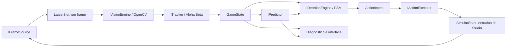

# Arquitetura

## Contratos e responsabilidades

| Pasta | Implementação |
|---|---|
| Core | Vetores, entidades, estados imutáveis, intenções, relógio monotônico, fila e orquestração |
| Capture | Ownership de frames, pool de Mat, janela, imagens com timeline, vídeo e simulação |
| Vision | HSV, morfologia, contornos, forma/contraste, template, NMS, fluxo óptico e homografia |
| Tracking | Associação por classe/distância, filtro alpha-beta, oclusão, ambiguidade e histórico limitado |
| Prediction | Velocidade constante, interceptação e erro observado em horizonte futuro |
| Decision | FSM, confiança, contexto, cooldown de ações e feedback de aproximação/chute |
| Input | Transporte substituível, macros, SendInput, leases, watchdog e hook de atalhos |
| UI | Painel WinForms e calibração; lê snapshots, sem processar visão na thread visual |
| Configuration | XML versionado, importação de macros antigas e perfis |
| Diagnostics | CPU/RAM, percentis de latência e JSONL com rotação |
| Tests | Runner independente, fixtures reais, estados simulados e benchmarks |

`Frame.Image` possui um único proprietário. O produtor entrega o frame à fila; a percepção assume sua propriedade ao removê-lo; `Dispose` devolve o Mat ao pool. Substituir um frame na fila libera o anterior imediatamente. A prévia usa outro bitmap com uma única posição pendente.

## Concorrência

- Captura: thread própria; frequência de perfil ou override; descarta trabalho visual quando desabilitado.
- Percepção: aguarda um evento; processa o frame mais recente; rejeita frames antigos; publica `Observation` com `GameState` e forecasts.
- Decisão: frequência independente; lê o snapshot sem esperar a captura; dados ausentes, antigos ou ambíguos produzem WAIT.
- Entrada: watchdog separado; aguarda sem polling quando ocioso; verifica foco e expiração a cada 20 ms quando há teclas ou macro pendentes.
- Atalhos: message pump próprio. F12 chama a liberação imediatamente, sem esperar o timer WinForms ou o OpenCV.
- Interface: snapshots e prévias a cada 1000/500/250 ms nos perfis econômico/equilibrado/avançado; iniciar/parar fontes e esperar threads acontece fora da thread visual. A frequência do diagnóstico não altera a percepção ou decisão; comandos e F12 são tratados por eventos.

A parada F12 é latched por instância do pipeline. Observação pode continuar, mas a execução fica bloqueada até reiniciar. Uma falha de captura/percepção/decisão também bloqueia entradas. Falhas de key-up são registradas no controlador e a liberação é repetida pelo watchdog enquanto houver teclas pendentes. Nenhum software consegue garantir que o sistema operacional aceite um SendInput bloqueado.

Despacho e liberação compartilham um lock. A marca de cancelamento é publicada antes de aguardar esse lock: uma chamada já em execução pode retornar, mas é liberada antes da conclusão de EmergencyStop e nenhuma ação posterior é despachada. A interface também serializa publicação do pipeline, macros manuais e interrupção, usando uma geração de cancelamento para rejeitar uma inicialização assíncrona antiga.

O tempo de processamento nativo de captura/codec não é preemptível pelo CancellationToken. O cancelamento de entradas é independente desse processamento; descarte/encerramento dos recursos aguarda o retorno da chamada nativa.

## Percepção

BALL utiliza segmentação HSV de regiões claras, remoção de linhas longas horizontais/verticais, união de painéis próximos, contornos, circularidade, proporções, contraste escuro interno e entorno verde. Template matching opcional acrescenta evidência. A pontuação é heurística, não uma probabilidade estatisticamente calibrada.

Regiões conhecidas do HUD podem ser excluídas por configuração. A exclusão também impede detectar uma bola encoberta por essas regiões. Linhas diagonais, efeitos visuais, sombras, uniformes claros, texturas e mudanças de zoom ainda podem causar erros.

LOCAL_PLAYER, ALLY, OPPONENT, GOAL e GOALKEEPER são reconhecidos por marcadores HSV apenas no cenário conhecido/calibrado. LOCAL_PLAYER também pode vir de referência fixa explicitamente marcada como não medida. FIELD_REFERENCE pode vir dos quatro cantos calibrados. O código não atribui semântica de equipe a cores arbitrárias de uma partida.

## Tracking e previsão

O tracker estima velocidade com `dt` real, faz associação com gates de distância e classe, reduz confiança diante de candidatos próximos e preserva uma trajetória perdida por até 1,2 s. Há no máximo 24 tracks e 12 observações por track nos padrões; os limites são configuráveis e validados.

Um fluxo óptico esparso de até 70 pontos estima a mediana do movimento da câmera. A dispersão do fluxo reduz confiança; mudanças de escala/região e saltos invalidam a extrapolação temporariamente. Mudança de origem de ROI é compensada nas coordenadas. Isso aproxima translação 2D; parallax, rotação ampla e zoom não são corrigidos por uma reconstrução geométrica completa.

O modelo futuro é posição + velocidade × horizonte. Forecasts carregam prazo, confiança e motivo de validade. Há no máximo 128 previsões pendentes para comparação com estados posteriores. O RMSE é medido sobre posições estimadas/interpoladas observadas posteriormente, não sobre ground truth 3D. São mantidas métricas separadas de BALL para não diluir seu erro com objetos estacionários.

`FieldProjector` oferece homografia testada para campo plano com quatro cantos, mas não alimenta a política de movimento deste MVP. Posições e velocidades dos demais módulos permanecem em pixels e pixels/s.

## Política de ação

Estados incluem IDLE, SEARCHING_BALL, TRACKING_BALL, MOVING_TO_TARGET, ATTACKING, DEFENDING, PREPARING_SHOT, RECOVERING e UNCERTAIN. O motor produz MOVE, AIM, SHOOT, PASS, DEFEND, WAIT e RECOVER.

Proximidade/co-movimento estável gera uma hipótese de posse, com confiança inferior para uma âncora não medida. Ausência de progresso provoca recuperação; velocidade da bola após uma finalização fornece feedback visual. Isso não prova posse real no Roblox.

Na simulação, as intenções modificam o ambiente e o ciclo seguinte volta a perceber apenas seus pixels. Ground truth da simulação é consultado pelos testes para verificar resultados e não é fornecido à visão/decisão.

## Recursos

| Perfil | Largura máxima padrão | Captura/percepção alvo | Decisão alvo |
|---|---:|---:|---:|
| ECONOMICO | 480 | 5 FPS | 15 Hz |
| EQUILIBRADO | 640 | 10 FPS | 20 Hz |
| AVANCADO | 960 | 15 FPS | 30 Hz |

Imagens menores não são ampliadas. FPS, Hz e largura podem ser sobrescritos na calibração/XML. ROI acompanha a bola nas fontes de janela; uma captura do campo inteiro é tentada periodicamente para recuperar contexto. Replay e simulação usam a imagem inteira para manter a demonstração reproduzível.

O OpenCV usa uma thread por padrão e o decoder de vídeo usa uma thread. O pool e a fila mantêm até três frames ativos no pipeline normal. Os percentis usam as últimas 128 medições. A qualidade adaptativa reduz largura/frequência sob CPU ou latência excessiva. O alvo de CPU é uma política de redução, sem hard cap imposto pelo Windows.

Logs usam um arquivo de aproximadamente 2 MB mais uma versão anterior. Não há rede neural, modelo generativo, serviço remoto ou necessidade de GPU dedicada.
